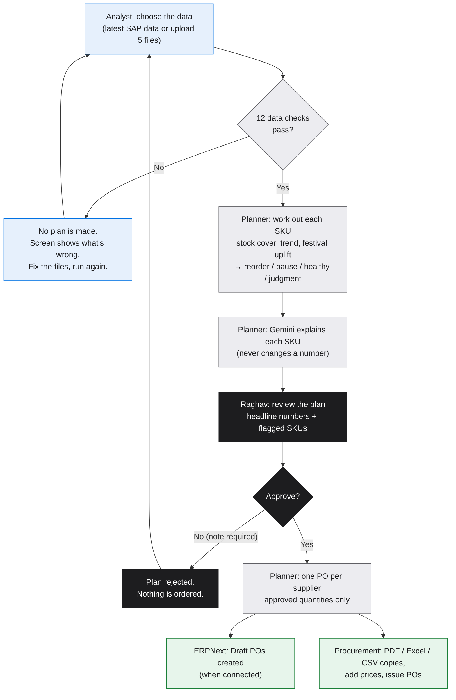

# Freshroots Reorder Planner — User Manual

**Website:** https://freshroots-reorder-planner.vercel.app · The same guide is on the site under **Guide**.

The planner turns this week's SAP sales and stock into a reorder plan using Raghav's rules.
The **Analyst** runs the plan, **Raghav** approves or rejects it, and on approval **one purchase
order per supplier** is raised for **Procurement**.

---

## 1. Flow chart

| Colour | Who |
|---|---|
| Blue | Analyst |
| Grey | Planner (automatic) |
| Black | Raghav |
| Green | Procurement and ERPNext |

---

## 2. Signing in

Open the website and press **Sign in**. Choose your role: **Analyst**, **Raghav Kulkarni** or **Procurement**.
Your **Home** screen then shows your one next step.

> The sign-in is a demo role picker for now. Add real logins before using it with live suppliers.

---

## 3. Analyst: run the plan

1. Go to **New run**.
2. Choose the data:
   - **Latest SAP data**: uses the files already uploaded (shows when and by whom), or
   - **Upload new files**: drop the five CSV files exported from SAP:
     `weekly_sales.csv`, `sku_master.csv`, `current_inventory.csv`, `calendar.csv`, `distributor_master.csv`.
3. Press **Run the plan**. The 12 data checks tick through one by one.
4. **All passed:** the plan opens. You're done; Raghav sees it on Home.
5. **A check failed:** no plan is made. Read the red message, fix the file, run again.
   - *"Stock data is recent" failed:* the stock date in `current_inventory.csv` is more than 7 days before today. Upload fresh data, or under **More options** set the **Run date** within a week of the stock date (for replaying old data).
6. **Optional, under More options → Send a SKU to Raghav:** add a SKU with a reason the data can't show (for example, a competitor promotion) and a valid-until date. That SKU goes to the judgment zone and isn't ordered automatically.

---

## 4. Raghav: approve or reject

1. **Home** shows *"Plan #N needs your decision"*. Press **Review the plan**.
2. Read the three headline numbers: SKUs to reorder, units to order, SKUs flagged.
3. Read the **flagged SKUs** listed in the decision panel. Tap any SKU (here or in the table) for:
   - 16 weeks of sales,
   - stock cover before and after the order, against the healthy window,
   - the rules that fired and the plain-language explanation.
4. Decide:
   - **Approve plan** → optional note → **Confirm approval**. Purchase orders are raised straight away.
   - **Reject plan** → note saying why (required) → **Confirm rejection**. Nothing is ordered.

You can't change a single SKU's quantity. To change something, reject the plan with a note and ask the Analyst to re-run.

---

## 5. Procurement: purchase orders

1. **Home** opens the latest approved plan. Or go to **Plans** and pick one marked *Approved*.
2. Each supplier has one **purchase order** tile: its lines, total units and status.
   - **In ERPNext as PUR-ORD-…**: created in ERPNext as a Draft. Press **Open in ERPNext**, add rates and the real Required By date, then submit it.
   - **ERPNext sync failed**: the tile says why (for example, a supplier or item missing in ERPNext). Fix it in ERPNext, then press **Retry ERPNext**.
   - **ERPNext not connected**: use the downloads and enter the PO in ERPNext by hand, then press **Entered manually** and type the reference.
3. **Download** gives a PDF, Excel or CSV of one PO. **All as ZIP** gives everything for the plan.
4. There are **no prices or lead times** in the source data. Add them in ERPNext.

---

## 6. Data

The **Data** page shows what the latest plan was built on (read-only):

- **SKUs:** name, supplier, perishability, standard order quantity, stock on hand, 16-week sales sparkline.
- **Suppliers:** name, region and how many SKUs each supplies.
- **Festival calendar:** festival months (expected demand +25%).
- **Overrides:** SKUs sent to Raghav by hand.

The data changes only with the next SAP upload.

---

## 7. What the colours mean

| Status | Meaning | What happens |
|---|---|---|
| **Stockout risk** (red) | Stock lasts less than the minimum weeks | Reorder now: standard quantity, or 1.5× if sales are rising more than 20% |
| **Overstock** (amber) | Stock lasts more than the maximum weeks | Pause the next order |
| **Healthy** (green) | Stock cover is inside the window | No order now; next order 1.5× if sales are rising |
| **Judgment zone** (grey) | The rules can't decide | Nothing ordered automatically |

**Healthy windows:** long-life SKUs 6–14 weeks of stock; perishable SKUs 3–4 weeks.

## 8. What the flags mean

A flag never changes a quantity; it asks for a closer look.

| Flag | Meaning |
|---|---|
| R1 | Even after the order, stock stays below the minimum |
| R2 | Within half a week of a limit: a close call |
| R3 | Sales spiked in a festival month; the uplift may count twice |
| R4 | The order pushes stock above the maximum |
| J1 | New product, or less than 12 weeks of sales |
| J2 | Sent to Raghav by hand, with a reason |
| J3 | No sales in 12 weeks, so cover can't be worked out |

---

## 9. Questions

**Who decides how much to order?** The rules engine, using Raghav's thresholds. Raghav approves or rejects the plan. AI only explains.

**Who can change a rule or threshold?** Only Raghav, with sign-off from Deepa Nair. See `RULEBOOK.md`, Section 16.

**What if ERPNext is down?** The approval still stands and the POs are kept. Each one shows the reason and can be retried.

**Where is the history?** **History** shows every plan, the rejection rate (the kill line is 40%), and the audit log of who did what and when.
